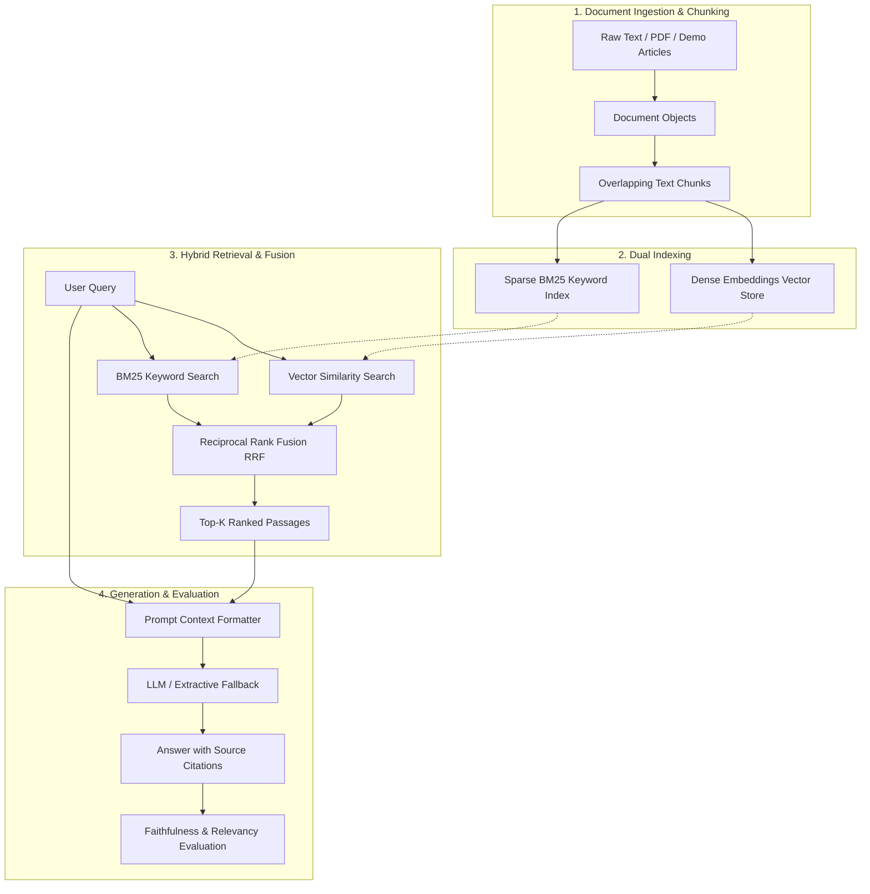

# RAG Engine 🧠

A clean, modular, and educational **Retrieval-Augmented Generation (RAG)** engine built from scratch.

This project is designed to clearly showcase **how a modern RAG system is built and works under the hood** — without unnecessary abstractions, domain lock-in, or complex type boilerplate.

---

## 🎯 What is RAG?

Large Language Models (LLMs) are knowledgeable, but suffer from two major problems:
1. **Knowledge Cutoffs**: They cannot know private files, internal notes, or information generated after training.
2. **Hallucination**: When uncertain, LLMs fabricate convincing but false claims.

**RAG solves this by turning query answering into an "open-book exam":**
Instead of forcing the LLM to memorize all information:
1. **Retrieve**: Find the most relevant chunks from your document library using hybrid search.
2. **Augment**: Paste those retrieved excerpts directly into the prompt as context.
3. **Generate**: Ask the LLM to synthesize an answer based *only* on the provided context, citing sources.

---

## 📐 Architecture & Pipeline Flow



---

## 🔍 Core Concepts Demonstrated

### 1. Document Chunking
Embedding an entire 50-page document into a single vector dilutes specific details. We split documents into manageable chunks (e.g., 300–400 words) with overlapping boundaries (50 words) to preserve context continuity.

### 2. Dense Vector Embeddings & Similarity Search
- Text is converted into high-dimensional vectors where semantic distance corresponds to conceptual similarity.
- Queries and chunks are compared using **Cosine Similarity**.
- Includes **`HashEmbeddings`** (zero model download, fast, 100% offline) and optional HuggingFace `SentenceTransformers`.

### 3. Sparse Keyword Search (BM25)
- Vector embeddings excel at conceptual meaning ("automobile" matches "car"), but can struggle with exact acronyms, numbers, or specific names (e.g. `NIRCam`, `15 millikelvin`, `L2`).
- **Okapi BM25** provides complementary lexical precision.

### 4. Hybrid Search via Reciprocal Rank Fusion (RRF)
Neither vector search nor keyword search is optimal alone. We fuse their ranked lists using **RRF**:
$$\text{RRF Score}(d) = \sum_{m \in \{\text{dense}, \text{bm25}\}} \frac{w_m}{k + \text{rank}_m(d)}$$
This guarantees that candidates scoring high on both semantic relevance and keyword accuracy rise to the top.

### 5. Context-Augmented Generation
The retrieved excerpts are structured into a prompt:
```
You are a helpful knowledge assistant. Answer questions using ONLY the provided context.
Rules:
1. Use only the provided context to answer. If the context is insufficient, say so.
2. Cite your sources using [Source: title] format.

Context:
[Source 1: Quantum Computing Fundamentals]
...
Question: What temperature must superconducting qubits be cooled down to?
```
If an OpenAI API key is set, the LLM generates a fluent answer. If no key is set, the engine falls back to an **offline extractive synthesis**, allowing full local experimentation for free.

### 6. Evaluation (Faithfulness & Relevancy)
- **Faithfulness**: Measures whether claims in the generated answer are grounded in the retrieved context.
- **Answer Relevancy**: Measures how directly the response addresses the user's question.

---

## 📁 Repository Structure

```
RAG-Engine/
├── src/rag_engine/
│   ├── __init__.py           # Package exports
│   ├── documents.py          # Document class & PDF/Text loaders
│   ├── chunking.py           # Text chunking with overlap
│   ├── embeddings.py         # HashEmbeddings & SentenceTransformers
│   ├── vector_store.py       # In-memory cosine vector store
│   ├── bm25_search.py        # BM25 keyword search index
│   ├── hybrid_search.py      # Reciprocal Rank Fusion (RRF)
│   ├── generator.py          # Prompt builder & LLM synthesis
│   ├── eval.py               # Faithfulness & relevancy metrics
│   └── pipeline.py           # Unified RAGPipeline orchestrator
├── config/
│   ├── settings.py           # Simple configuration & hyperparameters
│   └── prompts.py            # System prompts & templates
├── experiment/
│   └── rag_pipeline.ipynb    # Step-by-step interactive Jupyter tutorial
├── tests/
│   ├── fixtures/demo_corpus/ # Bundled demo articles (Quantum, JWST, Energy)
│   ├── test_documents.py
│   ├── test_chunking.py
│   ├── test_embeddings_and_vector_store.py
│   ├── test_bm25_and_hybrid.py
│   └── test_pipeline.py
├── app.py                    # Streamlit interactive web dashboard
├── run_tests.py              # Zero-dependency test runner
├── requirements.txt          # Python dependencies
└── pyproject.toml            # Project metadata
```

---

## 🚀 Quickstart

### 1. Clone & Install Dependencies
```bash
git clone https://github.com/JayanGupta/RAG-Engine.git
cd RAG-Engine

pip install -r requirements.txt
```

### 2. Configure Environment (Optional)
To use OpenAI for answer generation, copy `.env.example` to `.env` and set your key:
```env
USER_LLM_API_KEY=sk-...
USER_LLM_MODEL=gpt-4o-mini
```
*(If no API key is provided, the engine runs 100% offline with zero external network calls).*

### 3. Run the Tests
```bash
python run_tests.py
```
*(Runs all 14 tests verifying document loading, chunking, embeddings, BM25, hybrid retrieval, and pipeline generation).*

### 4. Launch the Interactive Web Dashboard
```bash
streamlit run app.py
```
Open [http://localhost:8501](http://localhost:8501) in your browser:
- **💬 Ask Question**: Query the knowledge base and see answers with cited sources.
- **🔬 Pipeline Inspector**: Watch the internal query flow through Dense Vector search, BM25 search, and RRF rank fusion.
- **📚 Knowledge Base**: Inspect loaded documents, paste new text, or upload PDFs.

### 5. Interactive Jupyter Notebook
Explore the step-by-step tutorial:
```bash
jupyter notebook experiment/rag_pipeline.ipynb
```

---

## 💻 Python API Usage Example

```python
from rag_engine.pipeline import RAGPipeline

# Initialize pipeline and load demo knowledge base
pipeline = RAGPipeline()
pipeline.load_demo_corpus()

# You can also add custom documents or PDFs:
# pipeline.add_document("Photosynthesis is the process...", title="Biology Notes")
# pipeline.add_pdf("path/to/paper.pdf")

# Query the pipeline
response = pipeline.query("What temperature must superconducting qubits operate at?")

print("Answer:", response["answer"])
print("Sources:", response["sources"])
print("Faithfulness:", response["evaluation"]["faithfulness"])
print("Latency:", response["latency_ms"], "ms")
```

---

## 📜 License
MIT License. Built for education and understanding of Retrieval-Augmented Generation.
