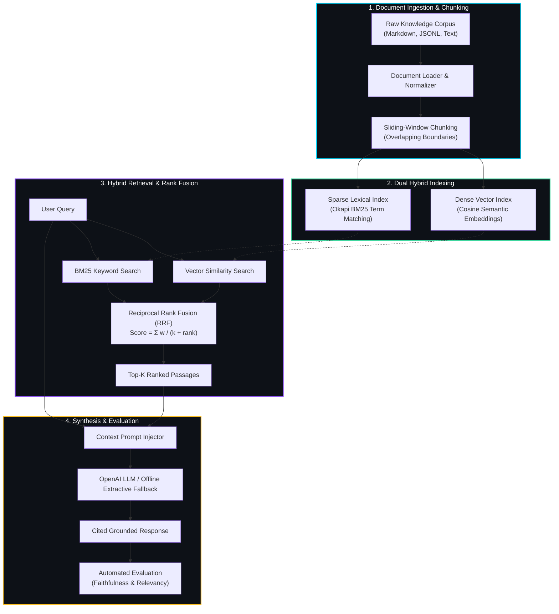

<div align="center">

<!-- Animated Typing Header -->
<a href="https://git.io/typing-svg"></a>

<br/>

<!-- Animated Wave Banner -->


<br/>

<!-- Badges Row 1: Repository Status -->


<br/>

<!-- Badges Row 2: Core Data Technologies -->


<br/>

<!-- Badges Row 3: Developer & Quality Tooling -->


<br/><br/>

<!-- Profile Views Counter -->


</div>

---


## About This Repository

> *A clean, modular, and educational **Retrieval-Augmented Generation (RAG)** engine built from the ground up — without restrictive third-party framework lock-ins, black-box abstractions, or bloated dependencies.*

Large Language Models (LLMs) excel at reasoning but suffer from **temporal knowledge cutoffs** and **hallucination**. This repository demonstrates how a production-ready RAG system solves these limitations by turning open-ended generation into an **open-book synthesis problem**:

1. **Retrieve**: Extract the most contextually relevant passages using **Hybrid Search** (combining Dense Semantic Vectors with Sparse Lexical BM25).
2. **Fuse**: Rank and synthesize multi-modal retrieval candidates using **Reciprocal Rank Fusion (RRF)**.
3. **Augment**: Ground LLM synthesis strictly on retrieved evidence with formatted source citations.
4. **Evaluate**: Score the output automatically for **Faithfulness** (factual grounding) and **Answer Relevancy**.

---


## End-to-End System Architecture



---


## Core Technical Concepts

### 1. Sliding Window Chunking
Embedding entire documents into single vectors dilutes granular details. We decompose documents into focused passages (e.g., 300 words) with overlapping spans (50 words) to guarantee conceptual continuity across chunk boundaries.

### 2. Dual Hybrid Search
* **Dense Semantic Embeddings**: Captures conceptual affinity (e.g., `"climate variation"` matches `"global warming"`). Includes zero-download offline hash embeddings and optional SentenceTransformers.
* **Sparse Okapi BM25**: Excels at verbatim keywords, technical acronyms, serial numbers, and exact entities (e.g., `NIRCam`, `15 millikelvin`, `ISO-8601`) where pure vector models often struggle.

### 3. Reciprocal Rank Fusion (RRF)
To unify rankings without requiring brittle calibration of raw vector distances and BM25 scores, we combine rankings using Reciprocal Rank Fusion:

$$\text{RRF Score}(d) = \sum_{m \in \{\text{dense}, \text{bm25}\}} \frac{w_m}{k + \text{rank}_m(d)}$$

### 4. Zero-Cost Offline Extractive Fallback
If an `OPENAI_API_KEY` is provided, the engine utilizes GPT models to synthesize fluent answers. When running locally without API credentials, the pipeline gracefully defaults to an **offline extractive synthesis engine**, making the entire codebase 100% free and runnable offline.

### 5. Automated RAG Triad Evaluation
* **Faithfulness**: Measures whether all assertions made in the generated answer are strictly substantiated by the retrieved context.
* **Answer Relevancy**: Verifies that the synthesized answer directly addresses the user query.

---


## Quick Start & Setup

### 1. Clone the Repository
```bash
git clone https://github.com/JayanGupta/RAG-Engine.git
cd RAG-Engine
```

### 2. Create Environment & Install Dependencies
```bash
python -m venv venv
# On Windows:
.\venv\Scripts\activate
# On Linux/macOS:
source venv/bin/activate

pip install -r requirements.txt
```

### 3. Optional Environment Configuration
Copy the template configuration:
```bash
cp .env.example .env
```
*(Optional: Insert your `OPENAI_API_KEY` in `.env` for generative answers. If left empty, the engine uses local extractive synthesis).*

### 4. Launch the Interactive Streamlit Web UI
```bash
streamlit run app.py
```
Open [http://localhost:8501](http://localhost:8501) in your browser to interact with the visual dashboard, adjust retrieval weights, and inspect chunk rankings.

---


## Programmatic Python Usage

```python
from src.rag_engine.pipeline import RAGPipeline
from src.rag_engine.documents import load_documents_from_jsonl

# 1. Initialize Pipeline & Ingest Knowledge Base
pipeline = RAGPipeline()
docs = load_documents_from_jsonl("data/documents.jsonl")
pipeline.index_documents(docs)

# 2. Query the Hybrid Search Engine
query = "What temperature must superconducting qubits be maintained at?"
result = pipeline.query(query, top_k=3)

# 3. Inspect Response, Citations & Metrics
print("Generated Answer:\n", result.answer)
print("\nSources Cited:")
for source in result.sources:
    print(f"- {source.title} (RRF Score: {source.score:.4f})")

print(f"\nFaithfulness: {result.metrics['faithfulness']:.2f}")
print(f"Relevancy:    {result.metrics['relevancy']:.2f}")
```

---


## Running the Verification Suite

Run unit and integration tests across chunking, dual indexing, BM25, and hybrid fusion:

```bash
# Run via pytest
pytest tests/ -v

# Or use the standalone runner
python run_tests.py
```

---


## Repository File Structure

```
RAG-Engine/
|-- app.py                                 # Streamlit visual interactive application
|-- pyproject.toml                         # Project metadata and tool configurations
|-- requirements.txt                       # Python dependencies
|-- run_tests.py                           # Standalone test runner script
|-- start.sh                               # Container entrypoint script
|-- README.md                              # Master repository documentation
|-- .env.example                           # Template environment configuration
|
|-- config/                                # System configuration & prompts
|   |-- settings.py                        # Search weights, chunk sizes & defaults
|   `-- prompts.py                         # LLM system & context augmentation prompts
|
|-- data/                                  # Demo corpus and benchmark knowledge bases
|   `-- documents.jsonl                    # Multi-domain articles (Science, Tech, Quantum)
|
|-- experiment/                            # Research & educational scratchpads
|   `-- rag_pipeline.ipynb                 # Interactive Jupyter step-by-step notebook
|
|-- src/rag_engine/                        # Core Modular RAG Engine
|   |-- chunking.py                        # Overlapping sliding window text splitter
|   |-- documents.py                       # Document abstractions & serializers
|   |-- embeddings.py                      # Dense vector embedding adapters
|   |-- vector_store.py                    # In-memory cosine similarity store
|   |-- bm25_search.py                     # Okapi BM25 sparse keyword search engine
|   |-- hybrid_search.py                   # Reciprocal Rank Fusion (RRF) algorithm
|   |-- generator.py                       # LLM and local extractive synthesis
|   |-- eval.py                            # Faithfulness & relevancy metrics
|   `-- pipeline.py                        # Unified end-to-end orchestration pipeline
|
`-- tests/                                 # Complete Pytest test suite
    |-- test_chunking.py                   # Chunk split & overlap unit tests
    |-- test_documents.py                  # Document validation tests
    |-- test_embeddings_and_vector_store.py# Cosine similarity verification
    |-- test_bm25_and_hybrid.py            # BM25 & RRF fusion scoring tests
    `-- test_pipeline.py                   # End-to-end integration tests
```

---


## Contributing

Contributions, bug fixes, and suggestions are welcome:

1. Fork the Project (`https://github.com/JayanGupta/RAG-Engine/fork`)
2. Create your Feature Branch (`git checkout -b feature/AdvancedReranker`)
3. Commit your Changes (`git commit -m "feat: add cross-encoder reranker support"`)
4. Push to the Branch (`git push origin feature/AdvancedReranker`)
5. Open a Pull Request

---


## Show Your Support

Give a star if this repository helped your understanding of Retrieval-Augmented Generation!

<div align="center">

[](https://star-history.com/#JayanGupta/RAG-Engine&Date)

</div>

---

<div align="center">

<!-- Animated Footer Wave -->


<br/>

<b>Engineered for AI Innovation by <a href="https://github.com/JayanGupta">Jayan Gupta</a></b>

<br/><br/>


</div>
