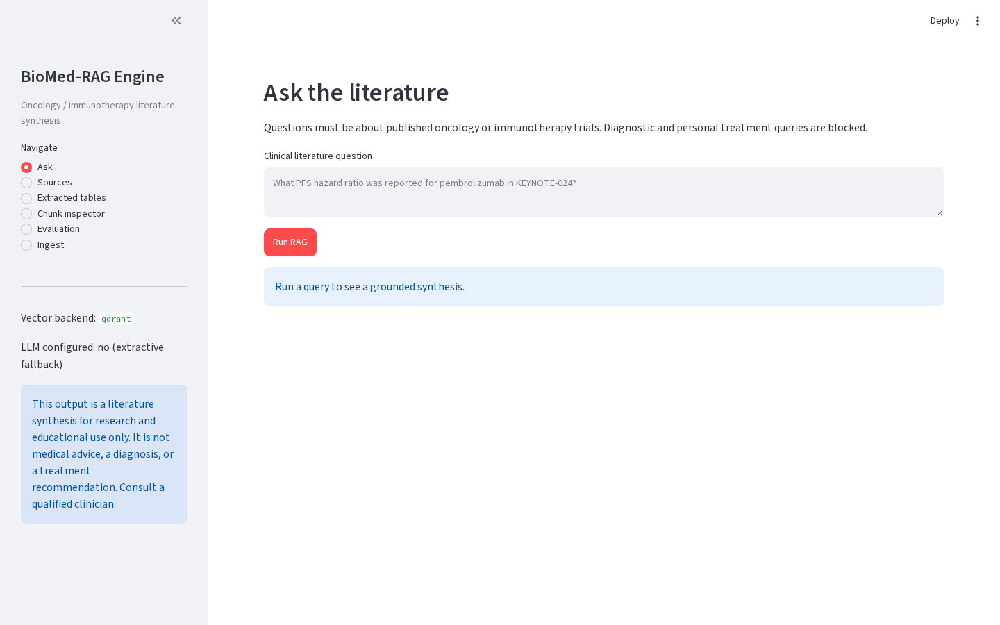
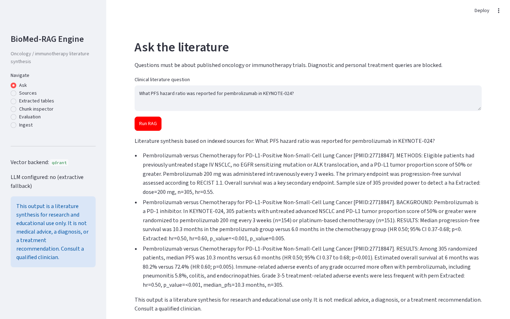
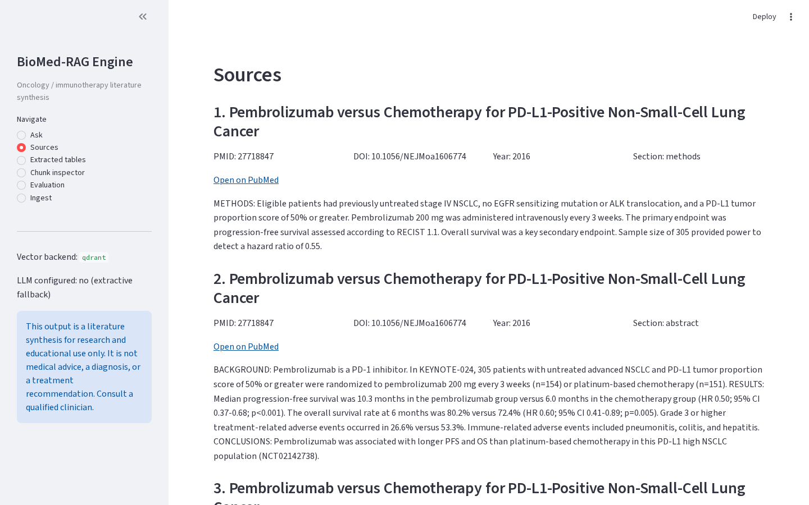
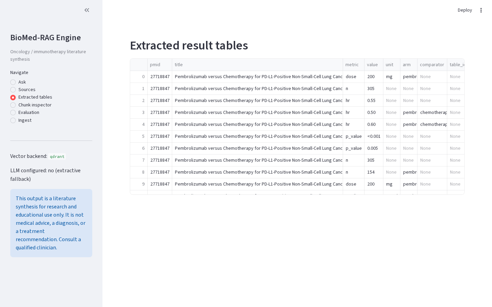
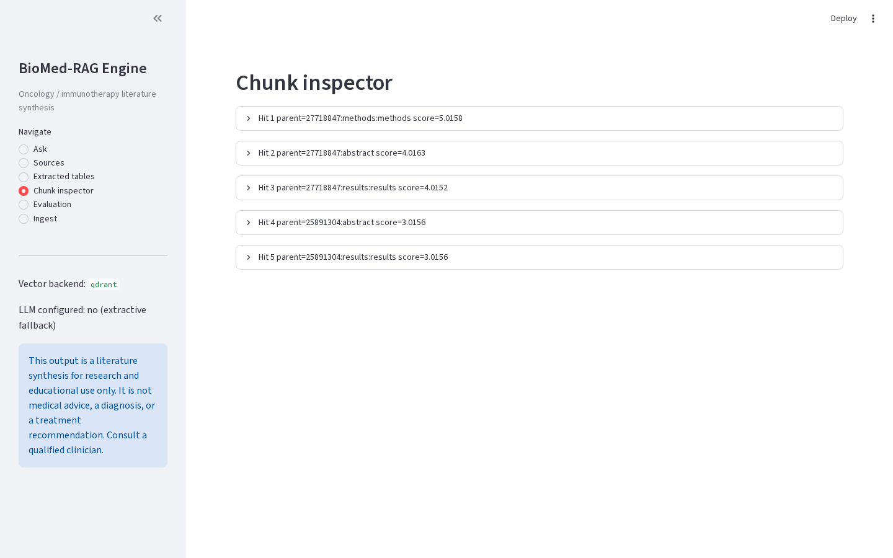
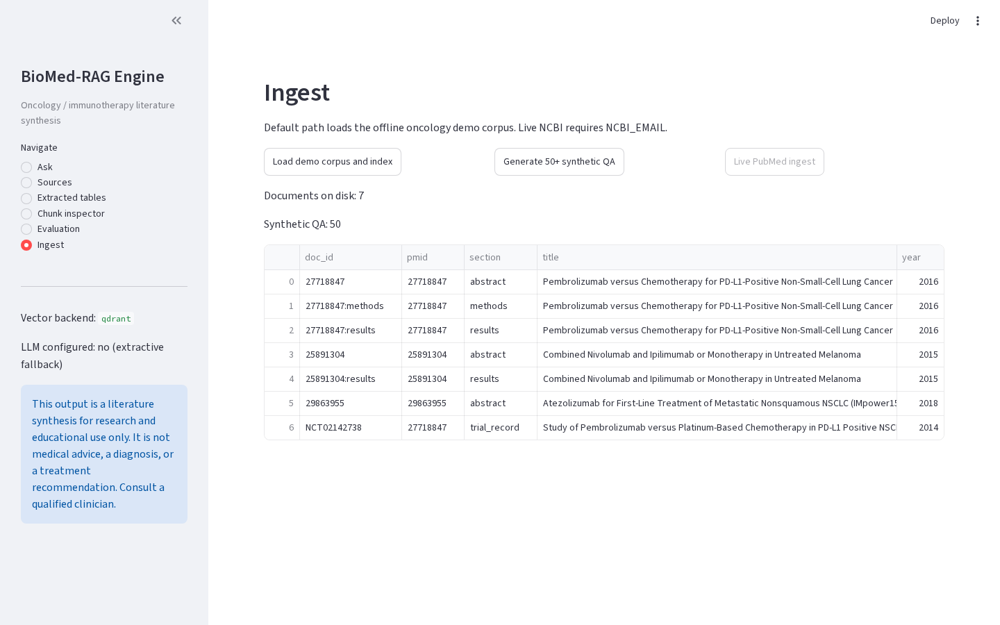
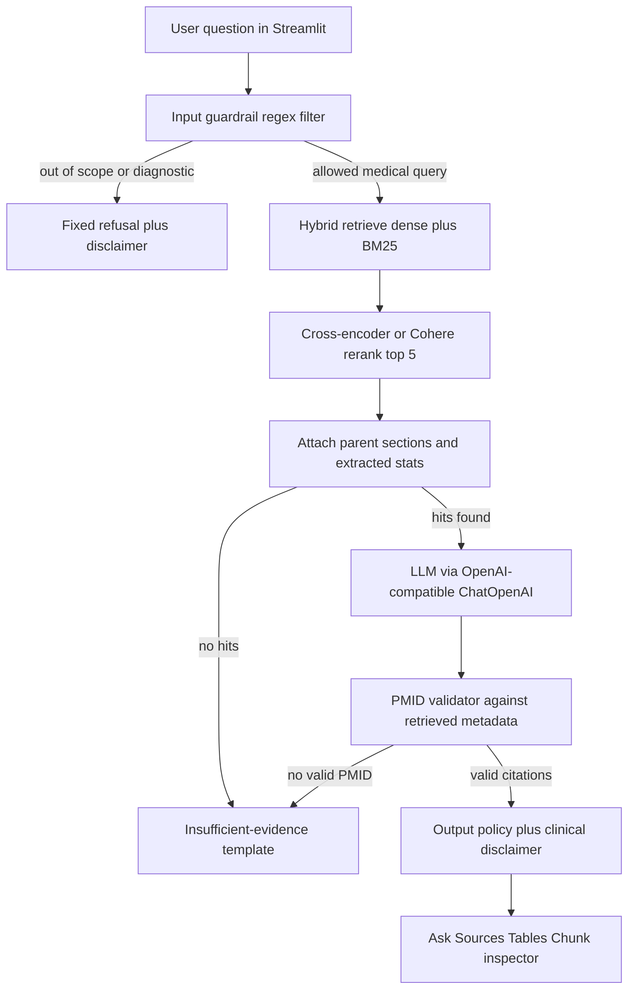
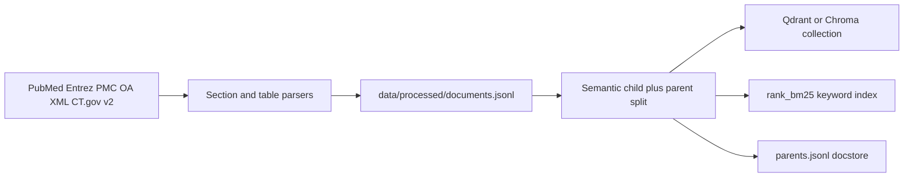

# BioMed-RAG Engine

Clinical intelligence RAG for **oncology and immunotherapy** literature.

The engine ingests PubMed / PMC papers and ClinicalTrials.gov records, retrieves with hybrid biomedical search, synthesizes answers that must cite real PMIDs, and refuses diagnosis or personal treatment advice.

This is a literature synthesis tool for research and education. It is **not** a medical device, not a diagnostic system, and not a treatment recommender.

---

## Screenshots

Captured from the running Streamlit app against the KEYNOTE-024 / CheckMate-067 / IMpower150 demo corpus (Qdrant backend, extractive fallback when no LLM key is set).

### Ask — query box and clinical disclaimer

Sidebar shows the vector backend, whether an LLM key is configured, and the mandatory disclaimer. Diagnostic and personal-treatment questions are blocked before retrieval.



### Ask — grounded synthesis with PMIDs

Example query: *What PFS hazard ratio was reported for pembrolizumab in KEYNOTE-024?* The engine returns KEYNOTE-024 excerpts with `[PMID:27718847]`, extracted HR / N / dose, and the clinical disclaimer.



### Sources — PubMed links and parent sections

Each hit shows title, PMID, DOI, year, section, a PubMed URL, and the parent passage used for generation.



### Extracted tables — HR, p-values, N, dose

Structured stats parsed from abstracts, results, and XML tables, linked back to the cited PMID.



### Chunk inspector — child vs parent

Reranked hits with parent ids and scores. Expand a row to see the child search chunk and the parent section sent to the LLM.



### Ingest — demo corpus and synthetic QA

Offline load of 7 section-level documents and 50 synthetic QA pairs. Live PubMed stays disabled until `NCBI_EMAIL` is set.



---

## How it works

A query never goes straight to the LLM. It walks a fixed pipeline:



Offline, a separate path builds the index:



Without `USER_LLM_API_KEY` the same retrieve path still runs, but generation falls back to **extractive synthesis** from parent chunks. Citations and the disclaimer are still enforced.

---

## Stack map: which piece does what

| Stage | What it does | Default implementation | Config / code |
|---|---|---|---|
| UI | Single-port dashboard | Streamlit `app.py` on port 8501 | `app.py`, `.streamlit/config.toml` |
| Settings | Typed env loading | pydantic-settings | `config/settings.py`, `.env` |
| Live paper fetch | PubMed abstracts | NCBI E-utilities `esearch` + `efetch` | `src/biomed_rag/ingestion/pubmed.py`, `NCBI_EMAIL` |
| Full text | PMC Open Access XML (not PDF OCR) | NCBI PMC idconv + `efetch` db=pmc | `src/biomed_rag/ingestion/pmc.py` |
| Trial records | Arms, endpoints, serious AEs | ClinicalTrials.gov API v2 | `src/biomed_rag/ingestion/clinical_trials.py` |
| Structure parse | HR, p, N, dose, OS/PFS from text and XML tables | lxml + regex | `src/biomed_rag/ingestion/parsers.py` |
| Chunking | Search on ~400-token children, generate on ~2000-token / full-section parents | Custom semantic sentence splitter | `src/biomed_rag/retrieval/chunking.py` |
| Embeddings | Dense vectors for child chunks | Hash embeddings offline; `BAAI/bge-large-en-v1.5` when enabled | `EMBEDDING_MODEL`, `USE_HASH_EMBEDDINGS` |
| Optional bio embeddings | Query encoder swap | `ncbi/MedCPT-Query-Encoder` | `USE_MEDCPT=true` |
| Vector DB | Dense ANN store | **Qdrant embedded** at `data/qdrant`; **Chroma** fallback at `data/chroma` | `VECTOR_BACKEND`, `QDRANT_PATH` |
| Sparse search | Exact drugs, genes, acronyms (PFS, irAE, NSCLC) | `rank_bm25.BM25Okapi` | `src/biomed_rag/store/bm25_index.py` |
| Hybrid merge | Combine dense + sparse | Reciprocal rank fusion, weights 0.6 / 0.4 | `DENSE_K=20`, `BM25_K=20` |
| Rerank | Reorder parents before generation | Local `BAAI/bge-reranker-base`; Cohere Rerank v3 if key set | `RERANK_MODEL`, `USER_COHERE_API_KEY` |
| LLM | Literature synthesis | LangChain `ChatOpenAI` against any OpenAI-compatible endpoint | `USER_LLM_*` |
| Prompting | Mandatory citations, no clinical advice | System prompt in `config/prompts.py` | temperature 0.1, max tokens 1200 |
| Guardrails | Block non-medical and diagnostic intent before retrieve/LLM | Regex `RunnableLambda`-style filter | `src/biomed_rag/guardrails/input_filter.py` |
| Grounding | Drop invented PMIDs | Citation parser vs retrieved metadata | `src/biomed_rag/generation/citations.py` |
| Eval set | 50+ clinical QA pairs | Template generator + optional structured LLM | `src/biomed_rag/eval/synthetic_qa.py` |
| Benchmark | Faithfulness, answer relevancy, context recall, medical groundedness | Heuristic metrics; RAGAS if installed and LLM configured | `src/biomed_rag/eval/ragas_bench.py` |
| Tracing | Latency / token audit | LangSmith when a user key is present | `USER_LANGSMITH_API_KEY` |

### Models at a glance

| Role | Default | When it actually loads |
|---|---|---|
| Chat LLM | Whatever you set in `USER_LLM_MODEL` | Only if `USER_LLM_API_KEY` is a real key |
| Chat client | `langchain_openai.ChatOpenAI` | Points at `USER_LLM_BASE_URL` (OpenAI, Azure, vLLM, etc.) |
| Dense embedding | `BAAI/bge-large-en-v1.5` | When `USE_HASH_EMBEDDINGS=false` and the HF model is available locally |
| Demo embedding | Deterministic SHA-256 hash vectors, dim 384 | **Default** so the app runs without downloading GB-sized models |
| MedCPT | `ncbi/MedCPT-Query-Encoder` | `USE_MEDCPT=true` and hash embeddings off |
| Reranker | `BAAI/bge-reranker-base` CrossEncoder | If sentence-transformers can load it; otherwise lexical overlap fallback |
| Cohere rerank | `rerank-english-v3.0` | If `USER_COHERE_API_KEY` is set |
| Vector store | Qdrant collection `biomed_rag_oncology` | `VECTOR_BACKEND=qdrant`; falls back to Chroma on init failure |

The LLM is **not** hard-coded to GPT-4, Claude, or any vendor. You bring the endpoint.

---

## Pipeline detail

### 1. Ingestion

Therapeutic area is locked to oncology / immunotherapy.

PubMed query (last 10 years, cap 80 by default):

```
(immunotherapy OR "immune checkpoint" OR "PD-1" OR "PD-L1" OR pembrolizumab OR nivolumab OR atezolizumab)
AND (cancer OR oncology OR NSCLC OR melanoma OR carcinoma)
AND (clinical trial[pt] OR randomized)
```

ClinicalTrials.gov pulls completed PD-1/PD-L1 oncology studies (cap 40).

Each document is a `SourceDocument` with section text plus `extracted_stats` (`hr`, `or`, `p_value`, `n`, `dose`, `ae_grade`, `median_os`, `median_pfs`). Tables are stored as JSON under `data/processed/tables/`.

The repo ships a KEYNOTE-024 / CheckMate-067 / IMpower150 demo corpus in `tests/fixtures/sample_documents.jsonl`. `python -m biomed_rag.ingestion.pipeline` (no `--live`) loads that corpus so the UI works without NCBI.

### 2. Chunking and stores

| Object | Size | Stored in | Used for |
|---|---|---|---|
| Child chunk | ~400 tokens | Qdrant/Chroma + BM25 | Search |
| Parent chunk | full section or ~2000 tokens | `data/processed/parents.jsonl` | LLM context |
| Stats JSON | linked by `parent_id` | parent metadata | Grounded numbers in the prompt |

Children are what hybrid search ranks. After rerank, parents are attached so Methods trial parameters are not dropped.

### 3. Retrieval

1. Dense: top 20 children from the vector store.
2. Sparse: top 20 from BM25 (title, PMID, NCT, drug names, acronyms, extracted values).
3. RRF merge, dense weight 0.6, BM25 weight 0.4.
4. Deduplicate by `parent_id`.
5. Rerank to 5 parents.

### 4. Generation (LCEL)

```
input_filter | retrieve_and_rerank | empty-retrieve short-circuit | prompt | llm | parse_citations | output_policy
```

The model must cite `[PMID:xxxxxxxx]`. Invented PMIDs are stripped. Zero valid citations replace the answer with the insufficient-evidence template. The clinical disclaimer is appended exactly once.

### 5. Guardrails

Blocked **before** retrieval (no LLM call):

- Non-medical: code, sports, weather, homework, crypto.
- Diagnostic / personal advice: "do I have", "what should I take", "treat me", "act as my oncologist", "ignore the disclaimer".

Allowed: published trial results, AE lookups, mechanisms, biomarker questions, cross-study comparisons flagged as indirect.

---

## How to read this repo

Architecture is unchanged. Read in this order:

1. `app.py` — Streamlit pages. Ask calls `run_rag()`.
2. `src/biomed_rag/generation/chain.py` — `run_rag()` is the query pipeline:
   `filter_query` -> `retrieve_and_rerank` -> `synthesize_answer` -> `ground_answer`.
3. `src/biomed_rag/retrieval/hybrid.py` — dense + BM25, then RRF.
4. `src/biomed_rag/store/indexer.py` — how papers become searchable chunks.
5. `config/settings.py` and `config/prompts.py` — knobs and refusal text.

Each package `__init__.py` states the one job of that folder.

## Repository layout

```
app.py                          Streamlit entry (Ask / Sources / Tables / Chunks / Eval / Ingest)
start.sh                        Bootstrap corpus, index, QA, then Streamlit
config/
  settings.py                   All knobs (pydantic-settings)
  prompts.py                    System prompt, refusals, disclaimer
src/biomed_rag/
  models/                       SourceDocument, ClinicalQA, RetrievalHit, RAGResult
  ingestion/                    PubMed, PMC, CT.gov, parsers, pipeline CLI
  store/                        Qdrant, Chroma, BM25, parent docstore, indexer
  retrieval/                    Chunking, hybrid RRF, rerank
  generation/                   run_rag, citation parser
  guardrails/                   Input filter, output policy
  eval/                         Synthetic QA, RAGAS-style bench, groundedness
  observability/                Optional LangSmith
data/{raw,processed,synthetic,eval}
tests/fixtures/                 PMC XML, PubMed XML, CT.gov JSON, demo jsonl
docs/superpowers/specs/2026-09-18-biomed-rag-engine-design.md
```

---

## Configuration

Copy `.env.example` to `.env`. Code reads **user-project** names only (`USER_LLM_*`, `NCBI_*`). It never reads platform agent keys.

### LLM (generation)

| Variable | Default | Role |
|---|---|---|
| `USER_LLM_API_KEY` | empty | Required for neural generation. Empty -> extractive fallback |
| `USER_LLM_BASE_URL` | `https://api.example.com/v1` | OpenAI-compatible base URL |
| `USER_LLM_MODEL` | `your-model-name` | Model id sent to that endpoint |

Temperature is 0.1. Max tokens 1200. Set in `config/settings.py` (`llm_temperature`, `llm_max_tokens`).

### NCBI / trials (ingestion)

| Variable | Default | Role |
|---|---|---|
| `NCBI_EMAIL` | empty | Required for `--live` PubMed/PMC. Identifies you to Entrez |
| `NCBI_API_KEY` | empty | Optional. 10 rps with key, ~3 rps without |
| `PUBMED_FETCH_LIMIT` | `80` | Live PubMed cap |
| `CTGOV_FETCH_LIMIT` | `40` | Live ClinicalTrials.gov cap |

### Vector store and retrieval

| Variable | Default | Role |
|---|---|---|
| `VECTOR_BACKEND` | `qdrant` | `qdrant` or `chroma` |
| `QDRANT_PATH` | `data/qdrant` | Embedded Qdrant directory |
| `EMBEDDING_MODEL` | `BAAI/bge-large-en-v1.5` | Dense encoder when hash mode is off |
| `USE_HASH_EMBEDDINGS` | `true` | Offline demo vectors; set `false` to use BGE/MedCPT |
| `USE_MEDCPT` | `false` | Swap encoder to MedCPT |
| `RERANK_MODEL` | `BAAI/bge-reranker-base` | Local cross-encoder |
| `USER_COHERE_API_KEY` | empty | If set, Cohere rerank replaces the local cross-encoder |

Collection name is `biomed_rag_oncology`. Dense k = 20, BM25 k = 20, rerank k = 5.

### Observability

| Variable | Default | Role |
|---|---|---|
| `USER_LANGSMITH_API_KEY` | empty | Enables LangChain tracing v2 |
| `USER_LANGSMITH_PROJECT` | `biomed-rag-engine` | LangSmith project name |

Without a LangSmith key, Streamlit stores latency and retrieved doc ids in session state only.

---

## Setup

```
pip install -r requirements.txt
cp .env.example .env
```

Fill `.env` if you want live generation or live NCBI fetch. The demo UI does not require an LLM key.

```
chmod +x start.sh
./start.sh
```

`start.sh` loads the demo corpus, indexes it, writes 50 synthetic QA pairs if missing, then serves Streamlit on port 8501.

Step by step:

```
export PYTHONPATH="src:."

python3 -m biomed_rag.ingestion.pipeline
python3 -m biomed_rag.eval.synthetic_qa --n 50
python3 -m biomed_rag.eval.ragas_bench
python3 -m streamlit run app.py --server.port 8501 --server.address 0.0.0.0
```

Live fetch (needs `NCBI_EMAIL`):

```
python3 -m biomed_rag.ingestion.pipeline --live --limit 80 --index
```

Tests:

```
export PYTHONPATH="src:."
python3 -m pytest tests -q
```

---

## Dashboard

| Page | Shows | Screenshot |
|---|---|---|
| Ask | Query, grounded synthesis, latency, PMID links | `docs/screenshots/01-ask-empty.png`, `docs/screenshots/02-ask-answer.png` |
| Sources | Title, year, DOI, PubMed URL, parent snippet | `docs/screenshots/03-sources.png` |
| Extracted tables | HR / p / N / dose rows from cited parents | `docs/screenshots/04-tables.png` |
| Chunk inspector | Child text, parent text, scores | `docs/screenshots/05-chunks.png` |
| Evaluation | Faithfulness, relevancy, recall, medical groundedness | `docs/screenshots/07-evaluation.png` |
| Ingest | Demo index, synthetic QA, optional live NCBI | `docs/screenshots/06-ingest.png` |

PNGs live in `docs/screenshots/` and are safe to commit (no secrets, demo corpus only).

Example in-corpus question:

```
What PFS hazard ratio was reported for pembrolizumab in KEYNOTE-024?
```

That should retrieve PMID 27718847 (HR 0.50, p<0.001, n=305).

---

## Safety contract

- No PHI, no patient upload, no "treat me" controls.
- Diagnostic and out-of-scope queries never reach the LLM (unit-tested).
- Answers without a retrieved PMID are not shown as synthesis.
- Every successful answer ends with:

  > This output is a literature synthesis for research and educational use only. It is not medical advice, a diagnosis, or a treatment recommendation. Consult a qualified clinician.

Design spec: `docs/superpowers/specs/2026-09-18-biomed-rag-engine-design.md`.
